---
theme:
  name: catppuccin-mocha
  override:
    footer:
      style: template
      left: "@orhun.dev"
      right: "bcnrust"
---

<!-- new_lines: 2 -->

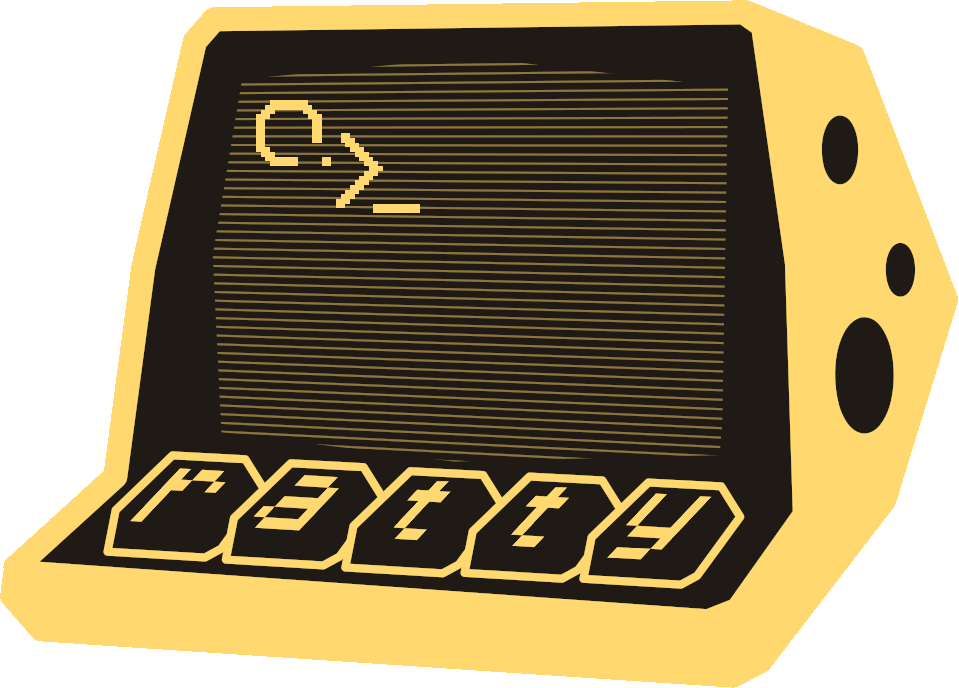

<!-- alignment: center -->

<span style="color: #ffd970">**Beyond Text: Building a 3D terminal emulator in Rust**</span>

---

<span style="color: #ff7a36">**Orhun Parmaksız**</span>

Rust Developer Advocate @`JetBrains`  
Lead Maintainer @`Ratatui`

<!-- end_slide -->

# I spend a lot of time thinking about terminals...

<!-- pause -->

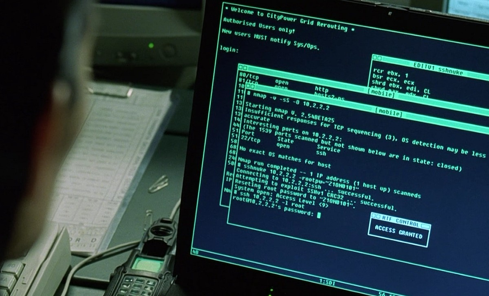

<!-- alignment: center-->

This is where I spend a lot of my day.

<!-- no_footer -->

<!-- end_slide -->

# What is a terminal?

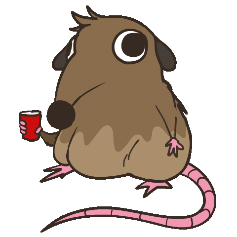

<!-- alignment: center -->

You tell me!

<!-- no_footer -->

<!-- end_slide -->

# What is a terminal?

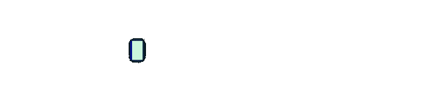

```svgbob
   You                  Terminal              Shell
    │                       │                   │
    ├── type command ──────▶│──────────────────▶│
    │                       │                   │
    │◀── see response ──────│◀──────────────────│
    │                       │                   │
```

<!-- no_footer -->

<!-- end_slide -->

### I mainly work on Ratatui

<!-- alignment: center -->

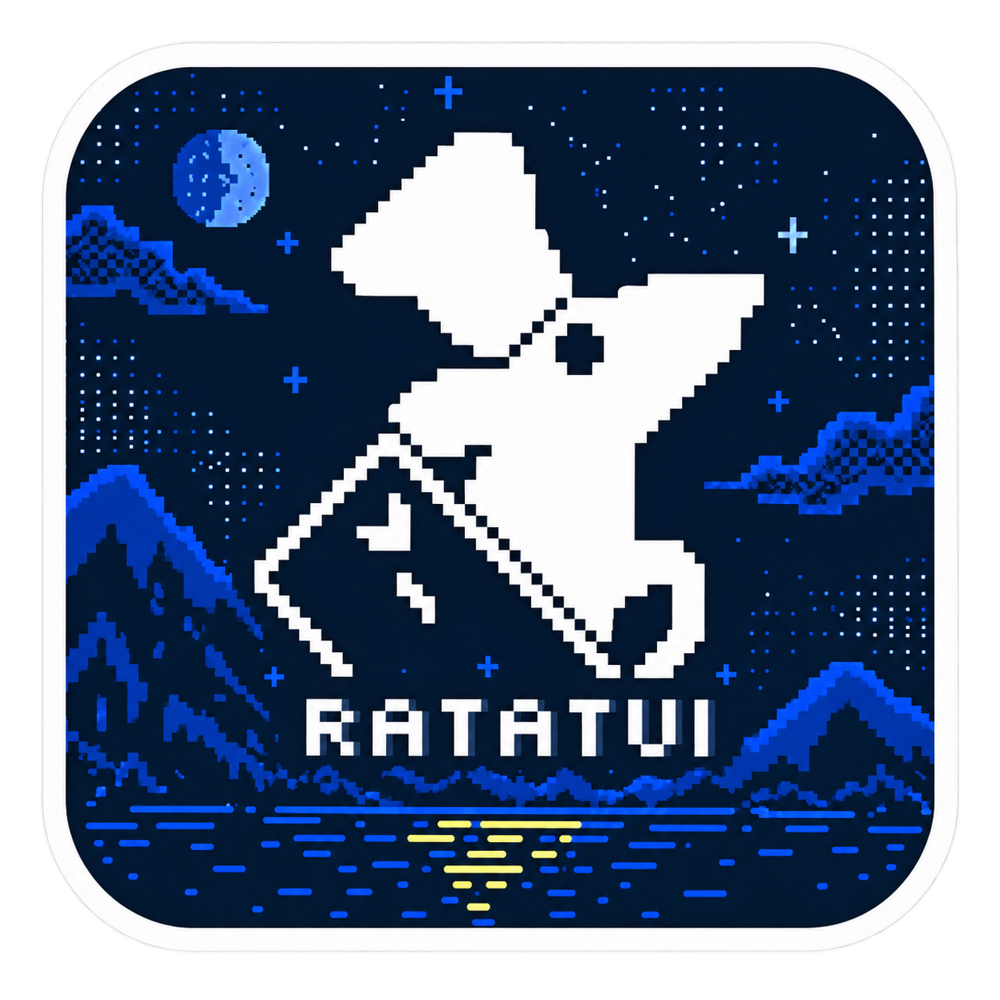

A Rust library for building terminal user interfaces.

`ratatui.rs`

<!-- no_footer -->

<!-- end_slide -->

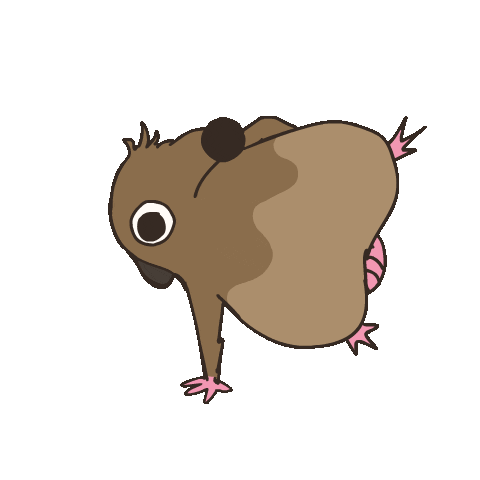

<!-- alignment: center -->

How does it work?

<!-- no_footer -->

<!-- end_slide -->

```svgbob
        0     1     2     3     4     5     6
     ┌─────┬─────┬─────┬─────┬─────┬─────┬─────┐
   0 │  R  │  a  │  t  │  a  │  t  │  u  │  i  │
     ├─────┼─────┼─────┼─────┼─────┼─────┼─────┤
   1 │     │  ▲  │     │     │     │     │     │
     └─────┴─ │ ─┴─────┴─────┴─────┴─────┴─────┘
              │
       ┌──────┴──────┐
       │   symbol    │
       │     "a"     │
       └─────────────┘
```

<!-- alignment: center -->

<!-- pause -->

Unicode connecting blocks: `─ │ ┌ ┐ └ ┘ ├ ┤ ┬ ┴ ┼`

<!-- no_footer -->

<!-- end_slide -->

<!-- column_layout: [2, 5] -->

<!-- column: 0 -->

## Widgets

- Block
- BarChart
- Calendar
- Canvas
- Chart
- Gauge
- LineGauge
- List
- Paragraph
- Scrollbar
- Sparkline
- Table
- Tabs
- ...

<!-- column: 1 -->

```bash +exec_replace +pty
/home/orhun/gh/ratatui/target/release/demo
```

<!-- no_footer -->

<!-- end_slide -->

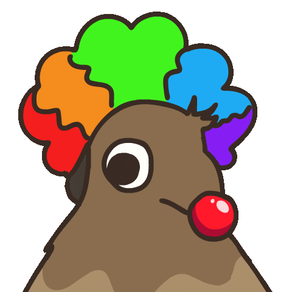

<!-- alignment: center -->

P.S. The slides are running in the terminal too!

[](https://github.com/mfontanini/presenterm)

And each Ratatui demo is also embedded in the slides.

<!-- no_footer -->

<!-- end_slide -->

```bash +exec_replace +pty
/home/orhun/gh/ratatui/target/release/examples/sparkline
```

<!-- no_footer -->

<!-- end_slide -->

```bash +exec_replace +pty
/home/orhun/gh/ratatui/target/release/examples/chart
```

<!-- no_footer -->

<!-- end_slide -->

```bash +exec_replace +pty
/home/orhun/gh/ratatui/target/release/examples/canvas
```

<!-- no_footer -->

<!-- end_slide -->

```bash +exec_replace +pty
/home/orhun/gh/ratatui/target/release/volatility-surface
```

<!-- no_footer -->

<!-- end_slide -->

# 3rd party widgets too!

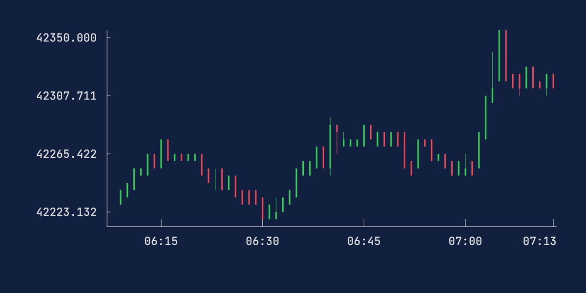

<!-- alignment: center -->

[](https://github.com/codingskynet/tui-candlestick-chart)

<!-- no_footer -->

<!-- end_slide -->

# tui-globe

A rotating 3D globe rendered in Braille characters.

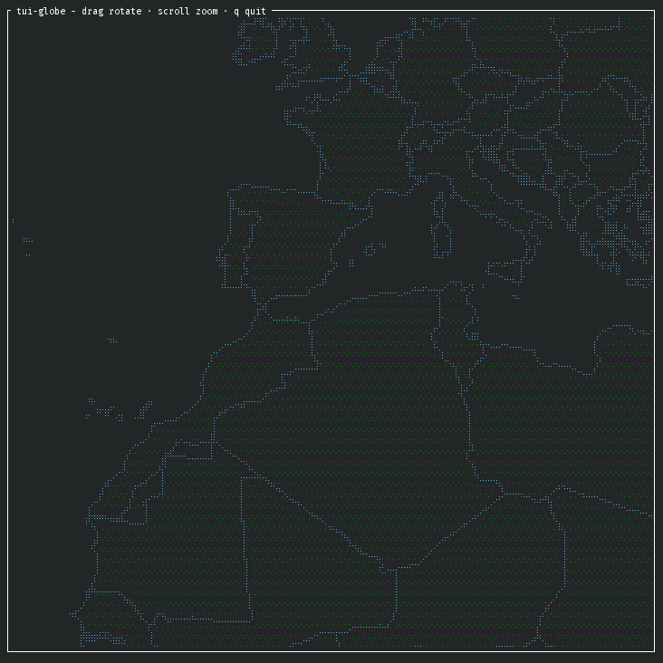

<!-- alignment: center -->

[](https://github.com/d10n/tui-globe)

<!-- no_footer -->

<!-- end_slide -->

# ratatui-image

Render images inside the terminal using Kitty, iTerm2, Sixel, or half-blocks.

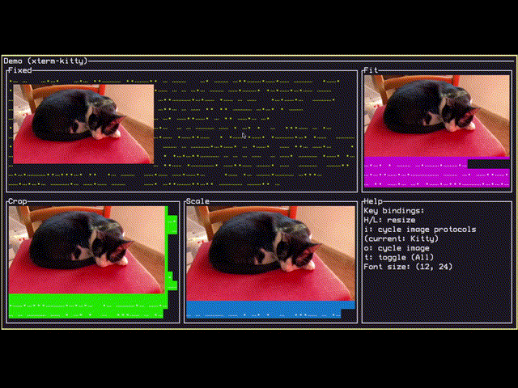

<!-- alignment: center -->

[](https://github.com/ratatui/ratatui-image)

<!-- no_footer -->

<!-- end_slide -->

```rust +line_numbers
struct Rat;

impl Widget for Rat {
    fn render(self, area: Rect, buf: &mut Buffer) {
        "🐀".render(area, buf);
    }
}

fn main() -> Result<()> {
    let mut terminal = ratatui::init();
    terminal.draw(|f| {
        f.render_widget(Rat, f.area());
    })?;
    ratatui::restore();
    Ok(())
}
```

<!-- no_footer -->

<!-- end_slide -->

#### How about apps?

<!-- pause -->

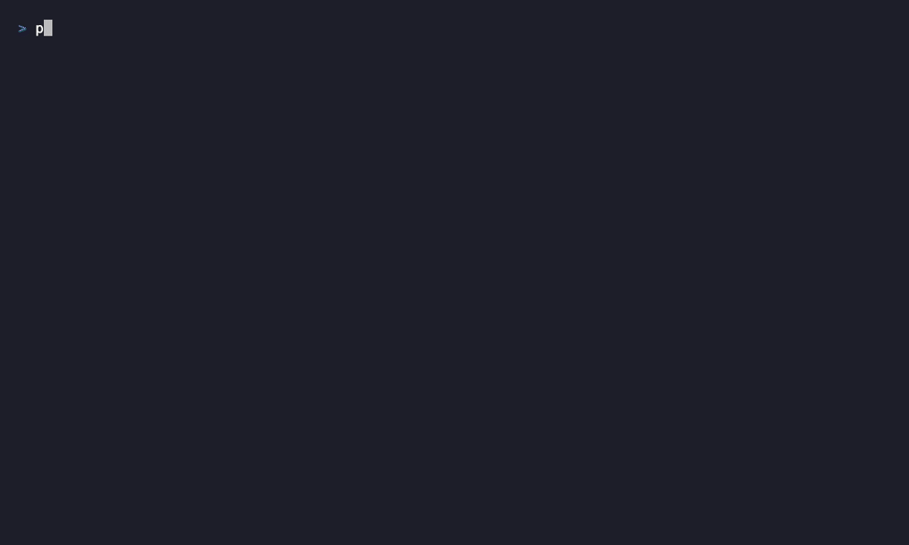

<!-- alignment: center -->

[](https://github.com/r14dd/patent)

<!-- no_footer -->

<!-- end_slide -->

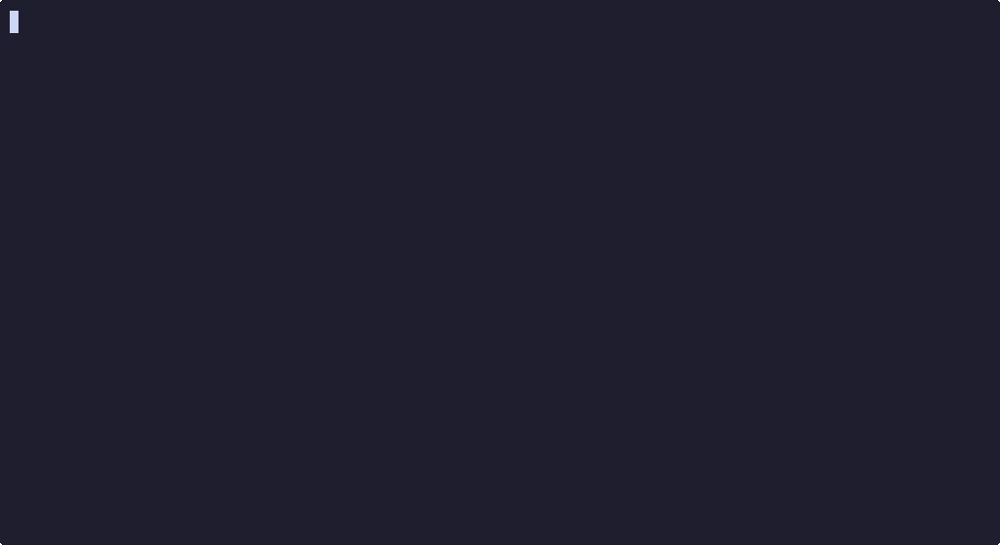

<!-- alignment: center -->

[](https://github.com/beeb/swpui)

<!-- no_footer -->

<!-- end_slide -->

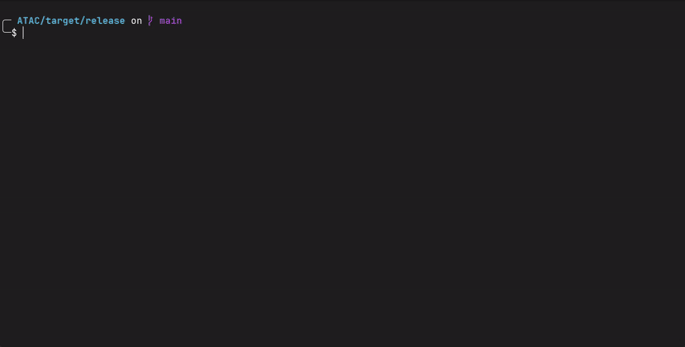

<!-- alignment: center -->

[](https://github.com/Julien-cpsn/ATAC)

<!-- no_footer -->

<!-- end_slide -->

## More?

- https://ratatui.rs/showcase/apps
- https://github.com/ratatui/tui-widgets
- https://github.com/ratatui/awesome-ratatui

<!-- pause -->

<!-- alignment: center -->

_But wait! We are not limited to terminal!_

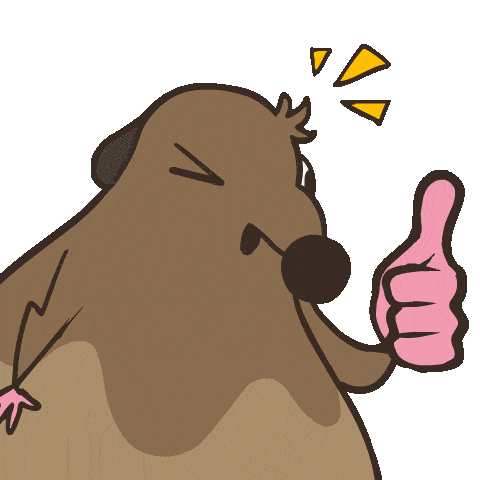

<!-- no_footer -->

<!-- end_slide -->

# Ratzilla 🦖

Build websites using Ratatui and WebAssembly!

```bash +exec
handlr open https://github.com/ratatui/ratzilla
```

<!-- no_footer -->

<!-- end_slide -->

# Mousefood 🧀

Embedded graphics backend for Ratatui!

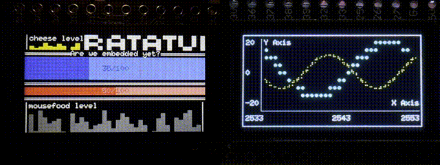

<!-- alignment: center -->

[](https://github.com/ratatui/mousefood)

<!-- no_footer -->

<!-- end_slide -->

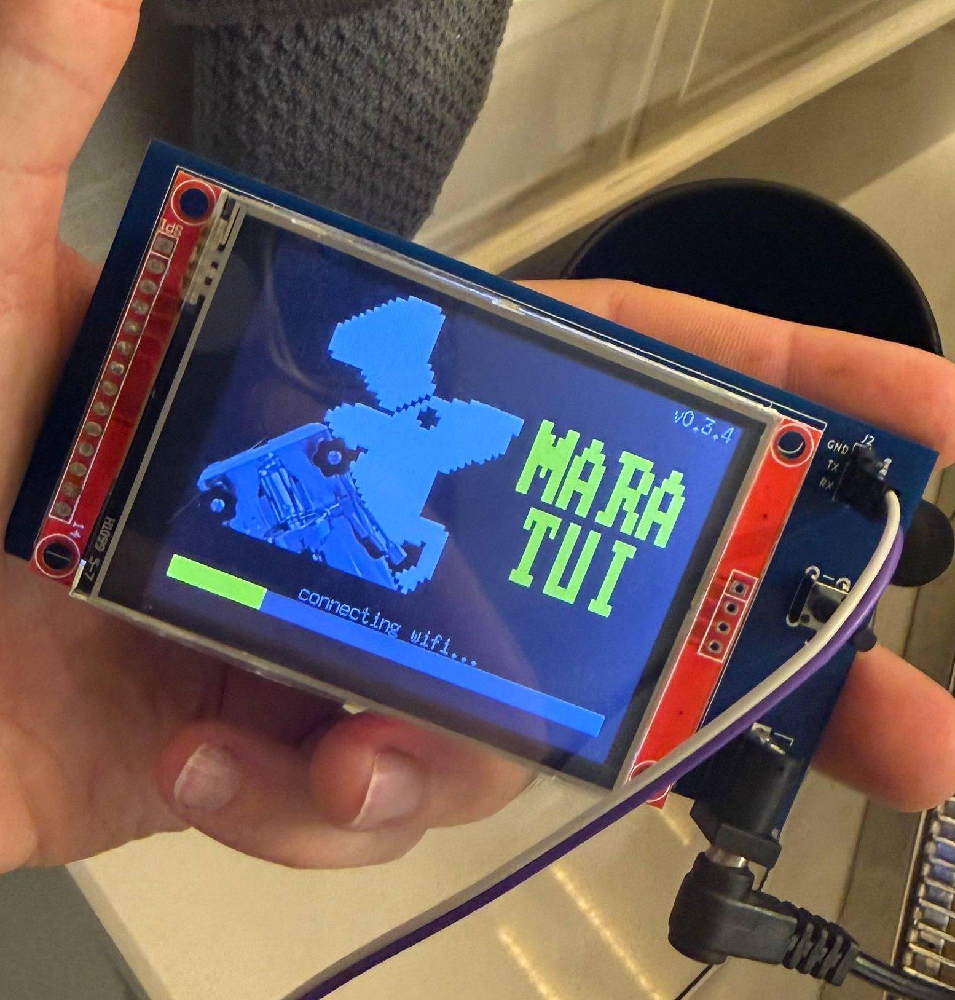

<!-- no_footer -->

<!-- end_slide -->

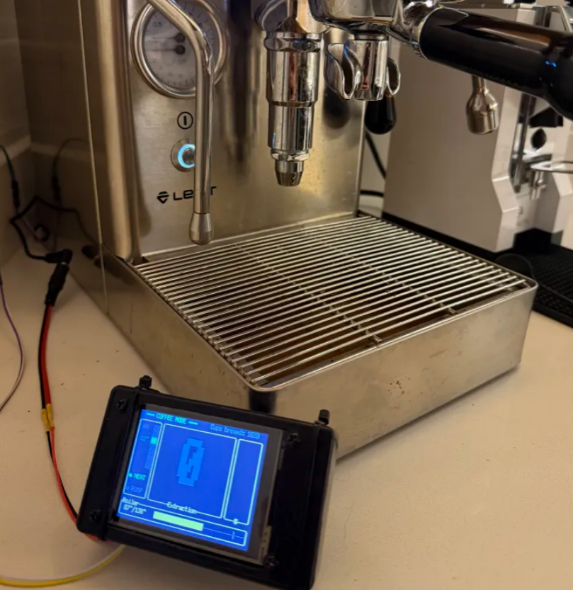

<!-- alignment: center -->

[](https://github.com/ololonly/maratui)

<!-- no_footer -->

<!-- end_slide -->

<!-- new_lines: 2 -->

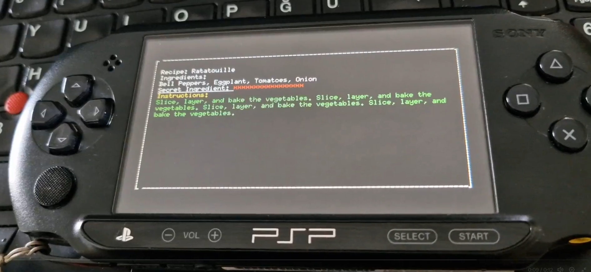

<!-- alignment: center -->

[](https://github.com/overdrivenpotato/rust-psp)

<!-- no_footer -->

<!-- end_slide -->

### ratatui-unity

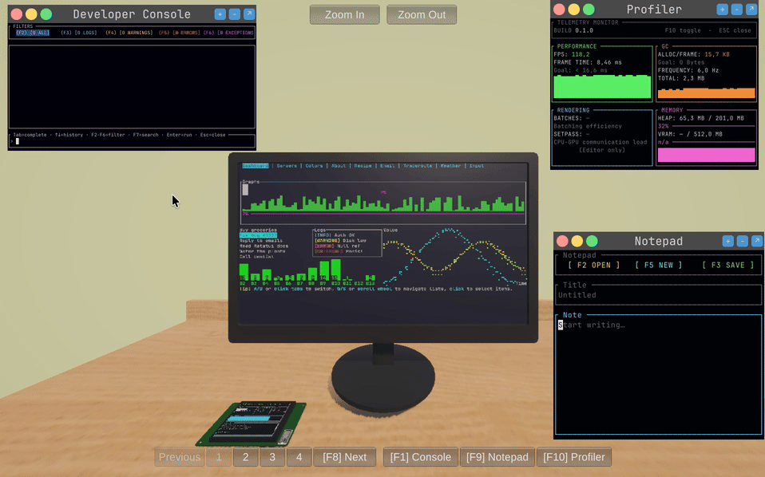

<!-- alignment: center -->

[](https://github.com/farukcan/ratatui-unity)

<!-- no_footer -->

<!-- end_slide -->

# bevy_ratatui

```rust
App::new()
    .add_plugins((
        MinimalPlugins.set(ScheduleRunnerPlugin::run_loop(frame_time)),
        RatatuiPlugins::default(),
    ))
    .add_systems(Update, draw_system)
    .run();

c.draw(|frame| {
    let text = ratatui::text::Text::raw("rat");
    frame.render_widget(text, frame.area());
})?;
```

<!-- alignment: center -->

[](https://github.com/ratatui/bevy_ratatui)

<!-- no_footer -->

<!-- end_slide -->

### Thinking about terminals

As I worked more in the terminal, I realized:

<!-- pause -->

_For all the things we do in a terminal,_  
_we mostly experience it as <span style="color: #ffd970">rows and columns of text</span>._

<!-- pause -->

Then I started wondering...

<!-- pause -->

What if the terminal could be more than text?

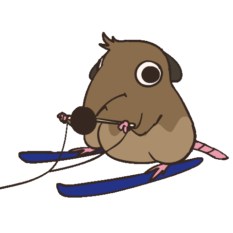

<!-- no_footer -->

<!-- end_slide -->

## This was not a new idea...

<!-- new_lines: 1 -->
<!-- pause -->

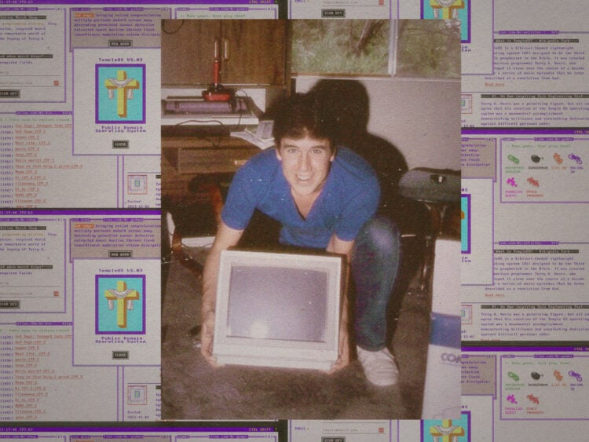

<!-- alignment: center -->

Terry Davis  
(1969 - 2018)

<!-- no_footer -->

<!-- end_slide -->

_"God said I made His temple."_

<!-- pause -->

# TempleOS

- A 64-bit operating system
- Designed to be a modern-day temple for God
- Built from scratch, including the kernel, compiler and libraries

<!-- pause -->

```bash +exec
QEMU_AUDIO_DRV= qemu-system-x86_64 -m 1G -enable-kvm -drive file=/home/orhun/temple
```

<!-- no_footer -->

<!-- end_slide -->

_"f*cking sprites, command-line... f*cking... f\*ck yeah"._

<!-- pause -->

## Sprites on the command-line

```bash +exec
handlr open "https://www.youtube.com/watch?t=1040&v=urO4RTEsPBg&feature=youtu.be"
```

<!-- pause -->

<!-- alignment: center -->

<span style="color: #ffd970">This was a big inspiration for me  
to think about terminals differently.</span>

<!-- no_footer -->

<!-- end_slide -->

<!-- no_footer -->

# Meet @gold-silver-copper 🦊

## soft_ratatui

Software rendering backend for Ratatui. No GPU required. TUI everywhere.

Used in `egui_ratatui` and `bevy_ratatui`

```bash +exec
mpv assets/soft-ratatui.avif >/dev/null
```

<!-- no_footer -->

<!-- end_slide -->

# Terminal Collective

A community of terminal enthusiasts.  
`https://terminalcollective.org`

And we created a cool animated terminal logo for our podcast!

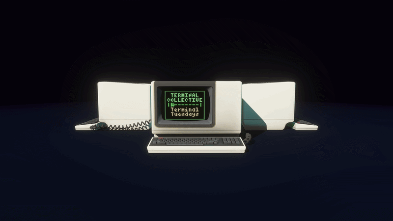

<!-- no_footer -->

<!-- end_slide -->

```svgbob
Render Pipeline
  ├─ Ratatui
  │  └─ Draws terminal UI
  ├─ Image texture
  │  └─ Converts UI into pixels
  ├─ Bevy material
  │  └─ Applies texture to terminal screen
  └─ Bevy render
      └─ Draws 3D scene with camera/effects
```

<!-- alignment: center -->

[](https://github.com/gold-silver-copper/rotating_terminal)

<!-- no_footer -->

<!-- end_slide -->

<!-- new_lines: 1 -->

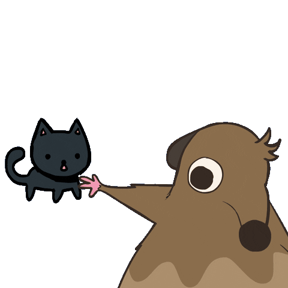

<!-- no_footer -->

<!-- end_slide -->

# Initial experiments

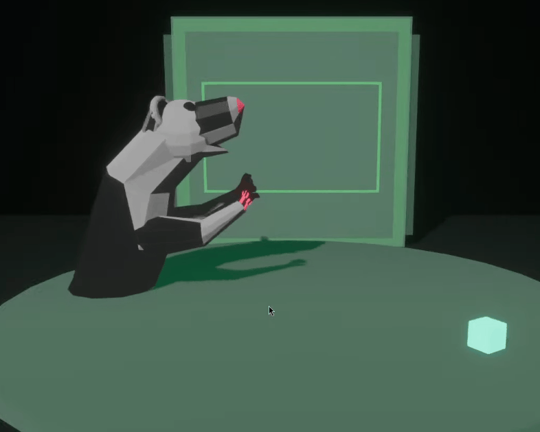

<!-- no_footer -->

<!-- end_slide -->

# First objective:

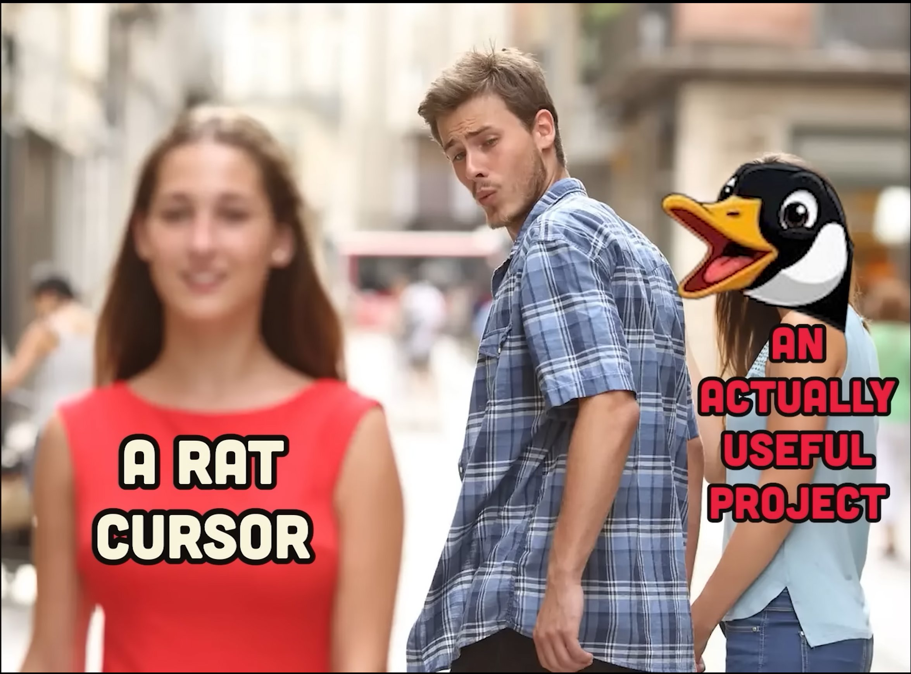

<!-- no_footer -->

<!-- end_slide -->

We need to draw the Ratatui terminal buffer into an image that Bevy can use as a texture.

<!-- pause -->

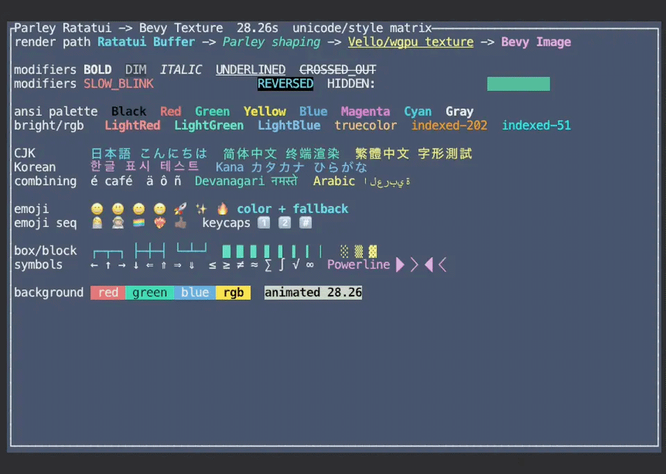

<!-- alignment: center -->

[](https://github.com/gold-silver-copper/parley_ratatui)

Does glyph shaping and uses Vello for GPU rasterization!

<!-- no_footer -->

<!-- end_slide -->

Initialize Ratatui with the Parley renderer:

```rust +line_numbers
let backend = ParleyBackend::new(cols, rows);
let mut terminal = Terminal::new(backend)?;
let renderer = TerminalRenderer::new(font_options, theme);
```

<!-- pause -->

Render the terminal screen and sync the cursor cell:

```rust +line_numbers
let screen = runtime.parser.screen();

terminal.draw(|frame| {
    frame.render_widget(TerminalWidget { screen, .. }, frame.area());

    if !cursor_model_visible && !screen.hide_cursor() {
        let (row, col) = screen.cursor_position();
        frame.set_cursor_position((col, row));
    }
})?;
```

<!-- no_footer -->

<!-- end_slide -->

Map the cursor cell into Bevy coordinates:

```rust +line_numbers
let cell_width = viewport_size.x / cols as f32;
let cell_height = viewport_size.y / rows as f32;

let (row, col) = screen.cursor_position();
let x = -viewport_size.x * 0.5 + (col as f32 + 0.5) * cell_width;
let y = viewport_size.y * 0.5 - (row as f32 + 0.5) * cell_height;
```

<!-- no_footer -->

<!-- end_slide -->

Spawn the rat cursor:

```rust +line_numbers
commands.spawn((
    CursorModel,
    SceneRoot(asset_server.load("rat.glb")),
    Transform::from_xyz(0.0, 0.0, 10.0),
));
```

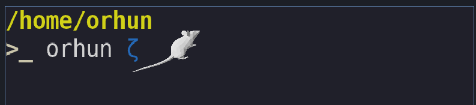

<!-- no_footer -->

<!-- end_slide -->

Animate it too!

```rust +line_numbers
let spin = elapsed_secs * 3.0;
let bob = (elapsed_secs * 5.0).sin() * cell_height * 0.15;

transform.translation = Vec3::new(x, y + bob, 10.0);
transform.rotation =
    Quat::from_rotation_y(spin) * Quat::from_rotation_x(-0.25);
transform.scale = Vec3::splat(cell_width.min(cell_height));
```

<!-- no_footer -->

<!-- end_slide -->

You can configure the cursor as well!

<!-- pause -->

# Meet Pasha 🐶

<!-- column_layout: [1, 1] -->

<!-- column: 0 -->

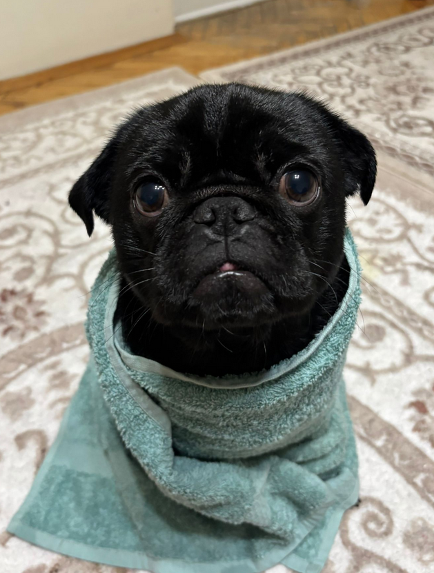

<!-- column: 1 -->

<!-- pause -->

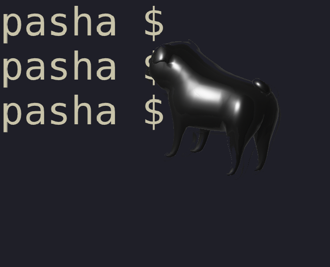

<!-- no_footer -->

<!-- end_slide -->

## From PTY output to a 3D scene

```svgbob
PTY output
   │ ANSI / VT sequences
   ▼
 fux-vt ── terminal state: cells, cursor, styles
   │
   ▼
 Ratatui buffer (CPU)
   │ changed cells
   ▼
 Bevy text renderer
   │ glyph + background quads
   ▼
 GPU-resident terminal surface
   │
   ▼
 Bevy scene: camera, models, effects
```

<!-- no_footer -->

<!-- end_slide -->

Sacrificing 300MB of RAM...
might as well make it worth it.

<!-- pause -->

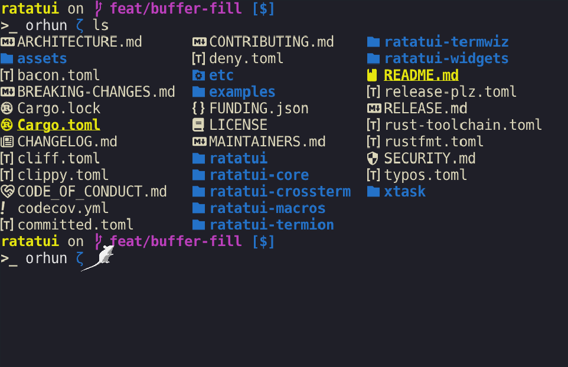

<!-- alignment: center -->

_3D mode of Ratty_

<!-- no_footer -->

<!-- end_slide -->

#### Tribute to Terry Davis

<!-- pause -->

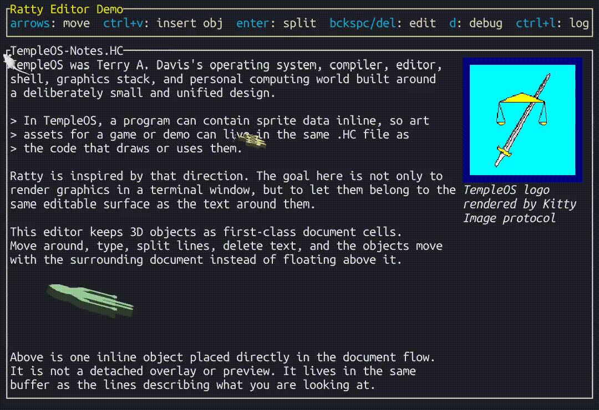

<!-- alignment: center -->

_TempleOS document demo of Ratty_

<!-- no_footer -->

<!-- end_slide -->

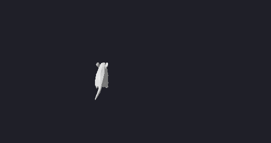

1. Register a 3D asset
2. Place it in terminal cell space (anchored to a row and column)
3. Let Ratty render it as part of the scene

<!-- pause -->

<!-- alignment: center -->

How do we communicate that to the terminal though? 🐀

<!-- no_footer -->

<!-- end_slide -->

# Ratty Graphics Protocol (RGP) 🐀

```svgbob
ESC _ ratty ; g ; <verb> [ ; <key=value> ... ] ESC \
      │       │    │             └── fields
      │       │    └──────────────── verb / operation
      │       └───────────────────── graphics namespace
      └───────────────────────────── protocol namespace
```

<!-- pause -->

<!-- alignment: center -->

- `s` for support query
- `r` for registering an object asset
- `p` for placing an object into terminal cell space
- `d` for deleting an object
- `u` for updating an object

<!-- no_footer -->

<!-- end_slide -->

Example queries:

```
ESC _ ratty;g;r;id=7;fmt=obj;path=CairoSpinyMouse.obj ESC \

ESC _ ratty;g;p;id=7;row=5;col=10;w=3;h=2;animate=1;scale=1.0;depth=1.5;color=7fd0ff;brightness=1.0 ESC \
```

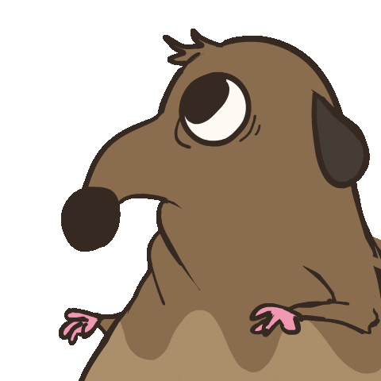

<!-- no_footer -->

<!-- end_slide -->

# ratatui-ratty

```rust
let mut graphic = RattyGraphic::new(
    RattyGraphicSettings::new("SpinyMouse.glb")
        .id(7)
        .format(ObjectFormat::Glb)
        .animate(true)
        .scale(1.0)
        .depth(1.5)
        .rotation([0.0, 30.0, 0.0]),
);

graphic.register()?;

let mut buf = Buffer::empty(Rect::new(0, 0, 80, 24));
(&graphic).render(Rect::new(10, 5, 24, 10), &mut buf);
```

<!-- alignment: center -->

[](https://docs.rs/ratatui-ratty)

<!-- no_footer -->

<!-- end_slide -->

# Examples

```bash +exec
ratty -e /home/orhun/gh/ratterm/widget/target/release/examples/rubiks_cube 2> /dev/null
```

<!-- pause -->

```bash +exec
ratty -e /home/orhun/gh/ratterm/widget/target/release/examples/draw 2> /dev/null
```

<!-- no_footer -->

<!-- end_slide -->

## Example app: `ratscad`

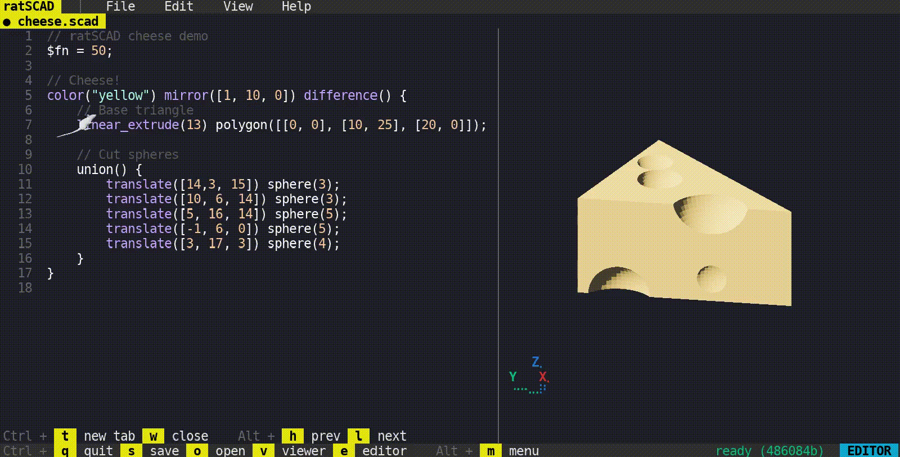

<!-- alignment: center -->

[](https://github.com/qewer33/ratscad)

<!-- no_footer -->

<!-- end_slide -->

## Example app: `comchan`

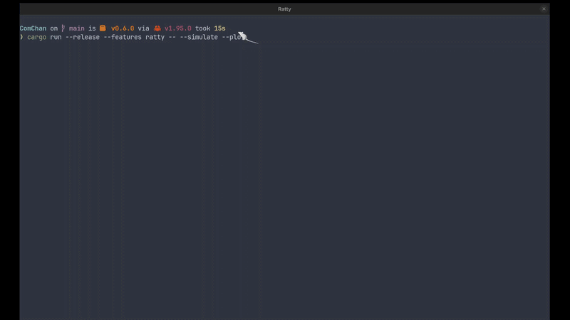

<!-- alignment: center -->

[](https://github.com/Vaishnav-Sabari-Girish/ComChan)

<!-- no_footer -->

<!-- end_slide -->

### Agent control!

Ratty includes an optional **Model Context Protocol (MCP)** server  
<span style="color: #ffd970">that lets an AI client control a running terminal.</span>

- Inspect the terminal
- Send text and key presses
- Make the terminal look however you imagine it!

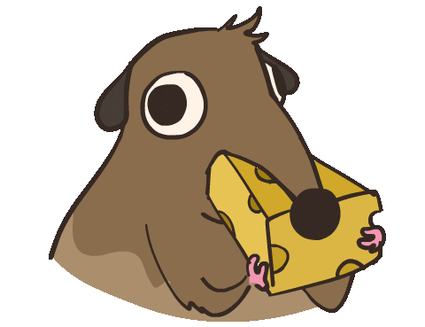

<!-- no_footer -->

<!-- end_slide -->

### Ratty MCP in action

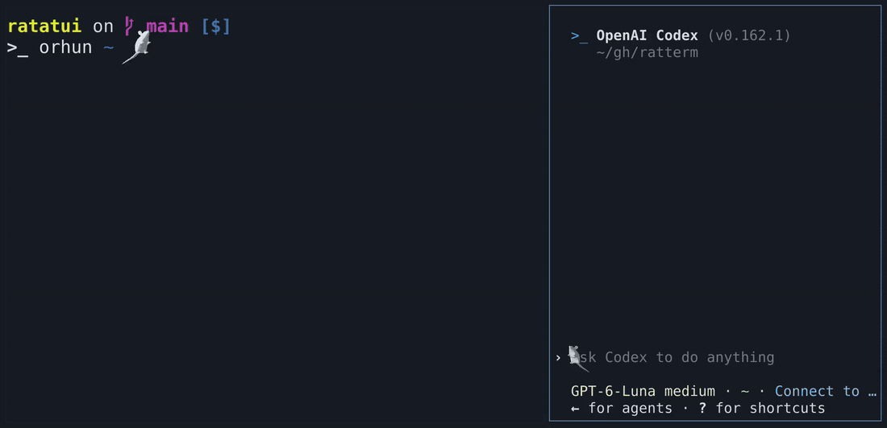

<!-- no_footer -->

<!-- end_slide -->

```text
MCP client (e.g. Codex)
        | starts ratty-mcp (MCP over stdin/stdout)
        v
   ratty-mcp
        | authenticated local control socket
        v
   Ratty GUI
        |
        v
  Running terminal
```

<!-- pause -->

<!-- alignment: center -->

## Live demo time! 🐀

Let’s give the terminal a new shape.

<!-- no_footer -->

<!-- end_slide -->

#### Why?

Why not?

Ratatui & Rust make things possible.

We're definitely in an age of _"because we could."_


<!-- no_footer -->

<!-- end_slide -->

<!-- new_lines: 2 -->

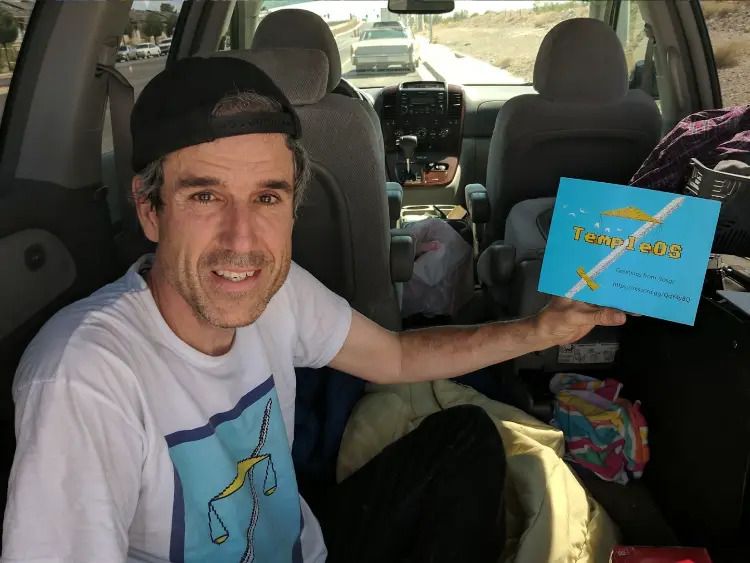

<!-- alignment: center -->

_"It's good to be king. Wait, maybe. I think maybe I'm just like a little bizarre little person who walks back and forth. Whatever, you know, but..."_

RIP King Terry 🫡

<!-- no_footer -->

<!-- end_slide -->

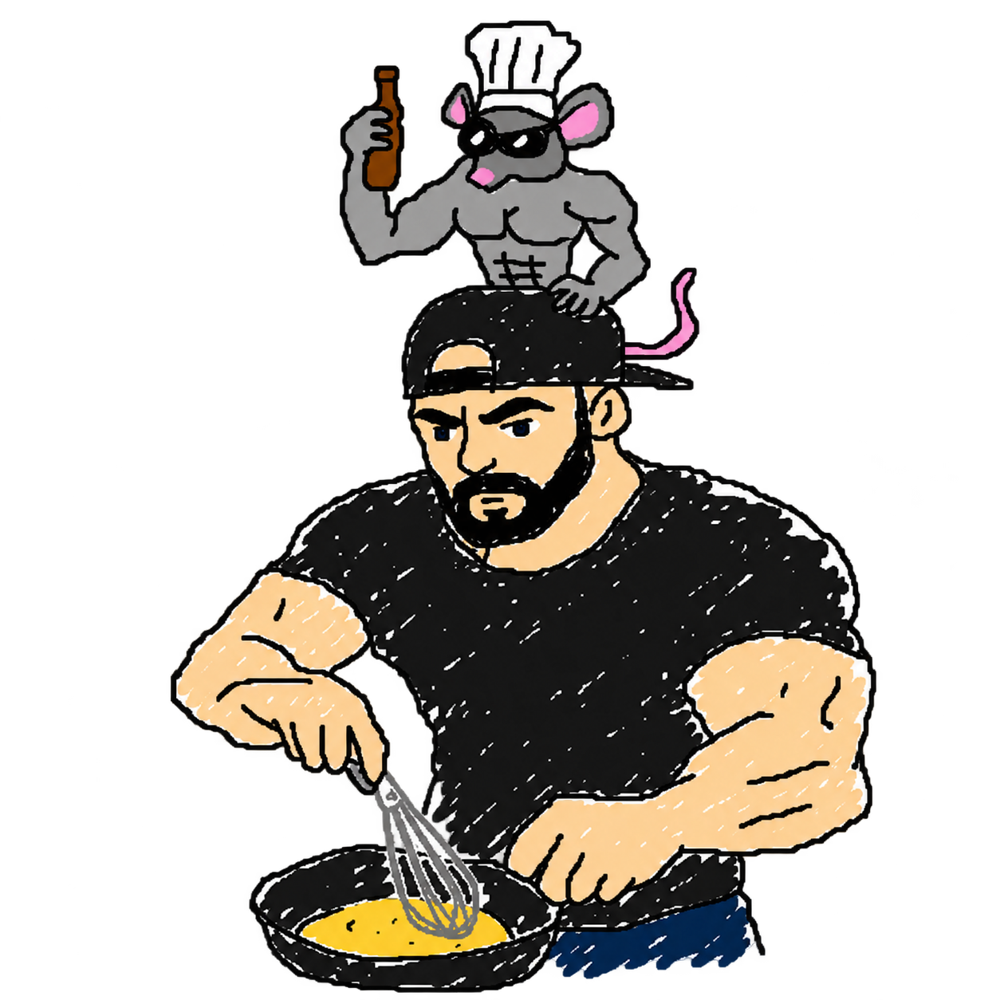

<!-- alignment: center -->

Thank you!  
`https://github.com/orhun/beyond-text`

@orhundev

<!-- no_footer -->
